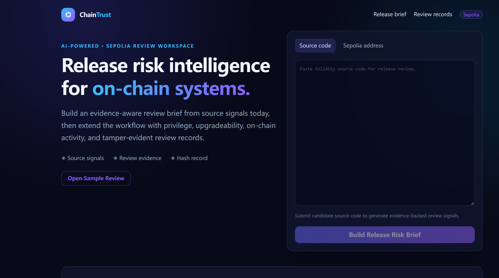
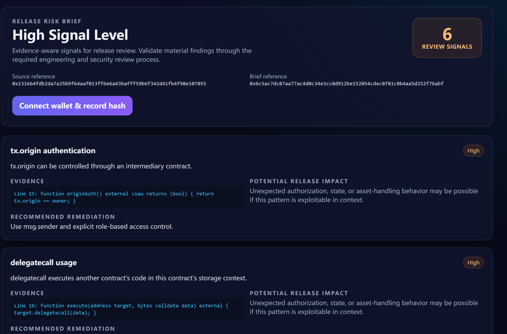
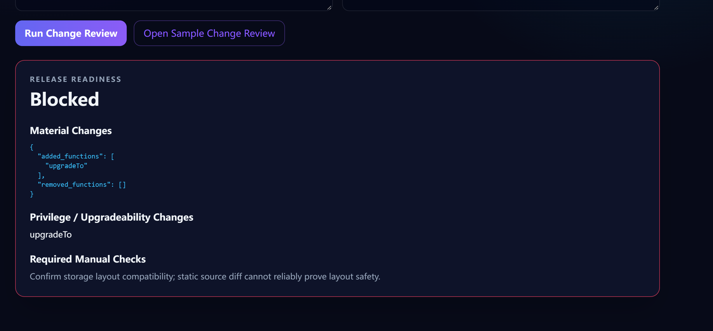

# ChainTrust

Smart contract release and risk intelligence workspace for Web3 engineering teams.

[View the portfolio case study](https://zhao-han-software-portfolio-cn.zhhan0711.chatgpt.site/projects/chaintrust)



ChainTrust turns Solidity source and Sepolia contract evidence into an evidence-aware Release Risk Brief. It combines deterministic source signals, privilege and proxy analysis, structured AI output, release-diff review, and a testnet registry that records source and report hashes.

> ChainTrust supports engineering review workflows. It does not replace a professional security audit and does not provide a security guarantee.

## Core workflow

```text
Solidity source or Sepolia address
              ↓
Static signals + privilege/proxy analysis
              ↓
Evidence-aware Release Risk Brief
              ↓
Source hash + report hash recorded on Sepolia
```

## Features

- Scan Solidity source for `tx.origin`, `delegatecall`, unchecked low-level calls, privileged-looking functions, and reentrancy-related ordering signals.
- Generate a structured risk brief with severity, code evidence, potential impact, remediation, and explicit limitations.
- Build a Sepolia contract profile from deployment, activity, privilege, and EIP-1967 proxy signals.
- Compare baseline and candidate source to highlight release-relevant privilege and upgradeability changes.
- Record source and report hash references in `AnalysisRegistry`; source and report content remain off-chain.
- Fall back to deterministic rule-based output when no OpenAI key is configured.
- Use explicitly marked Sandbox data when a live RPC provider is unavailable.

## Screenshots

### Release Risk Brief



### Change Review



## Architecture

```text
Next.js workspace ──REST──> FastAPI ──> source and chain analysis
       │                         │                 │
       │                         ├────────> OpenAI structured output
       │                         └────────> PostgreSQL
       │
       └── ethers.js ──Sepolia──> AnalysisRegistry (hash references only)
```

## Repository structure

```text
apps/
├── api/                 FastAPI routes, services, schemas, persistence, tests
└── web/                 Next.js workspace and review interfaces
packages/
└── contracts/           Solidity registry, Hardhat tests and deployment script
examples/                Safe test fixtures for scanner development
docker/                  API and web container definitions
docker-compose.yml       Local PostgreSQL, API and web stack
```

## Local setup

### Prerequisites

- Docker Desktop, or PostgreSQL 16+
- Node.js 22+
- Python 3.13+
- Optional Sepolia-compatible browser wallet

### Run with Docker Compose

```bash
cp apps/api/.env.example apps/api/.env
cp apps/web/.env.example apps/web/.env.local
cp packages/contracts/.env.example packages/contracts/.env
docker compose up --build
```

Open `http://localhost:3000`.

Only configure the external services needed for the workflow you want to run. The source-review fallback works without an OpenAI key.

## Configuration

| Variable | Service | Purpose |
| --- | --- | --- |
| `DATABASE_URL` | API | PostgreSQL or local SQLite connection |
| `OPENAI_API_KEY` | API | Optional structured AI narrative |
| `OPENAI_MODEL` | API | Model used for the structured report |
| `ETHERSCAN_API_KEY` | API | Optional verified-source and activity lookup |
| `SEPOLIA_RPC_URL` | API / contracts | Sepolia JSON-RPC provider |
| `DEPLOYER_PRIVATE_KEY` | contracts | Local deployment signer; never commit this value |
| `NEXT_PUBLIC_API_URL` | web | ChainTrust API base URL |
| `NEXT_PUBLIC_REGISTRY_ADDRESS` | web | Deployed `AnalysisRegistry` address |

All tracked `.env.example` files contain placeholders only. Never commit real keys or operator-specific configuration.

## Tests

### API

```bash
cd apps/api
python -m venv .venv
source .venv/bin/activate  # Windows: .venv\Scripts\activate
pip install -r requirements.txt
pytest
```

### Solidity contract

```bash
npm install
npm run test:contracts
```

The test suite covers scanner signals, structured API responses, source/address binding, Sepolia-only validation, change review behavior, hash recording, and zero-hash rejection.

## Sepolia deployment

```bash
npm run deploy:sepolia -w @chaintrust/contracts
```

After deployment, set `NEXT_PUBLIC_REGISTRY_ADDRESS` in the web application. The contract stores only hash references, timestamps, and the submitting wallet address.

## Responsible use

- Treat findings as review signals, not confirmed vulnerabilities.
- Validate material findings through engineering and professional security review.
- Do not submit confidential source to services you are not authorized to use.
- Do not deploy example contracts; they exist only as scanner fixtures.
- Keep private keys, API keys, RPC credentials, and database passwords outside Git.

## Contributing

See [CONTRIBUTING.md](CONTRIBUTING.md). Security issues should follow [SECURITY.md](SECURITY.md).

## License

MIT License. See [LICENSE](LICENSE).

